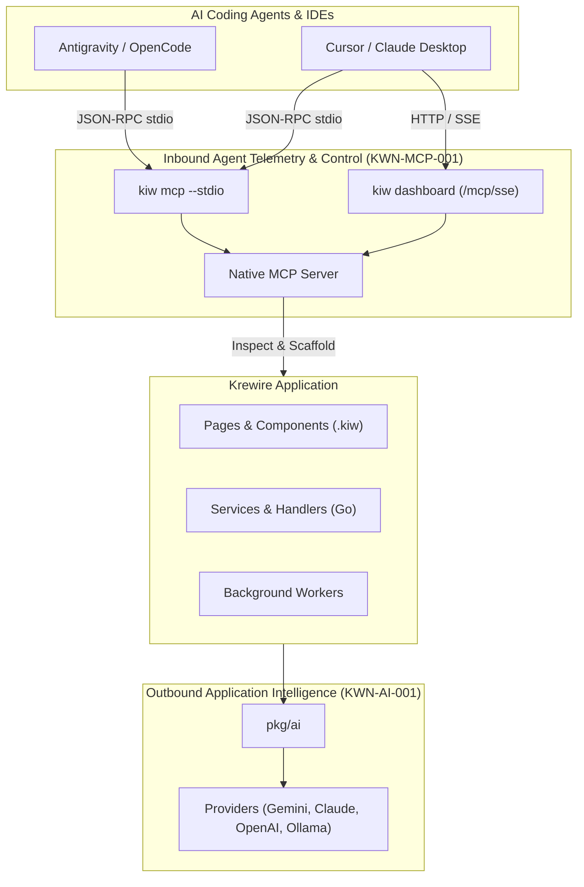

# Autonomous Agentic Development (KWN-AGI-001)

Krewire is designed from first principles as an **Agent-Native Web & Cloud Ecosystem**. 

Rather than treating AI as an external chatbot that pastes unverified code into your editor, Krewire establishes bidirectional, structured agentic communication protocols. AI coding agents (Antigravity, Cursor, Claude Desktop, OpenCode, Cline) connect directly into your project's runtime to inspect configurations, analyze routes, monitor memory telemetry, and invoke verified scaffolding tools.

---

## 1. Dual Agentic Architecture



1. **Inbound Protocol (Native MCP Server)**: Agents query and command your Krewire project using the open [Model Context Protocol (MCP)](https://modelcontextprotocol.io/).
2. **Outbound Intelligence (Unified Go AI SDK)**: Your applications, HTTP handlers, and background workers generate structured outputs (`ai.GenerateObject[T]`), stream tokens, and call tools using `pkg/ai`.

---

## 2. Setting Up Inbound MCP for AI Agents

Every Krewire project can instantly serve as an MCP server with zero configuration.

### A. IDE Setup with stdio (`kiw mcp --stdio`)

For **Cursor** (`.cursor/mcp.json`) or **Claude Desktop** (`claude_desktop_config.json`):

```json
{
  "mcpServers": {
    "krewire": {
      "command": "kiw",
      "args": ["mcp", "--stdio"]
    }
  }
}
```

For **OpenCode** (`opencode.json`):

```json
{
  "mcp": {
    "krewire": {
      "command": "kiw",
      "args": ["mcp", "--stdio"]
    }
  }
}
```

### B. Network / Browser Setup with HTTP/SSE

When developing microservices, containers, or using web-connected agents, start `kiw dashboard`:

```bash
kiw dashboard --port 4000
```

The MCP SSE server is automatically exposed at:
- **SSE Stream**: `http://127.0.0.1:4000/mcp/sse`
- **JSON-RPC Message Endpoint**: `http://127.0.0.1:4000/mcp/message`

---

## 3. Available MCP Resources & Tools

When an agent connects to `krewire-mcp`, it gains access to standardized resources and high-confidence actions:

### MCP Resources

| URI | Name | Description |
|---|---|---|
| `krewire://project/info` | Project Information | Project kind (`app`, `site`, `service`), title, Go toolchain, platform, and configured services. |
| `krewire://project/routes` | Routes Catalog | List of discovered `.kiw` pages, Markdown documents, and Go HTTP handlers. |
| `krewire://runtime/metrics` | Live Telemetry | Real-time memory allocation (MB), goroutines count, total sys memory, and GC stats. |
| `krewire://runtime/health` | Health Check | Continuous uptime and health status probe. |

### MCP Tools

| Tool Name | Parameters | Description |
|---|---|---|
| `kiw_inspect_project` | `{}` | Retrieve full project configuration, workload kind, and ecosystem topology. |
| `kiw_list_routes` | `{}` | Extract the entire routing catalog. |
| `kiw_make_scaffold` | `kind`, `name` | Safely scaffold a `component`, `page`, `handler`, `migration`, `model`, `middleware`, or `service` using verified generators. |
| `kiw_get_metrics` | `{}` | Query live goroutines and memory consumption. |
| `kiw_run_tests` | `pkg` (optional) | Execute `go test ./...` and return structured test outcome and output. |

---

## 4. Outbound Intelligence with `pkg/ai`

When your application needs to generate content, analyze user input, or run autonomous workflows, import `pkg/ai`:

```go
package main

import (
	"context"
	"fmt"
	"log"

	"github.com/krewire/krewire/pkg/ai"
	"github.com/krewire/krewire/pkg/ai/providers"
)

type CodeReview struct {
	Score       int      `json:"score" description:"Quality score from 1 to 10"`
	Suggestions []string `json:"suggestions" description:"Actionable improvements"`
}

func main() {
	client := providers.NewGeminiClient("gemini-2.5-pro", "")

	prompt := "Review this Go function: func Add(a, b int) int { return a + b }"
	review, err := ai.GenerateObject[CodeReview](context.Background(), client, prompt)
	if err != nil {
		log.Fatalf("Analysis failed: %v", err)
	}

	fmt.Printf("Quality Score: %d/10\n", review.Score)
	for _, s := range review.Suggestions {
		fmt.Printf("- %s\n", s)
	}
}
```

---

## 5. Installing the Boost AI Constitution

To equip your project with a full software development lifecycle agent matrix, run:

```bash
kiw boost install
```

This installs:
- `AGENTS.md` — The agent constitution and operational boundaries.
- `.cursor/mcp.json` & `opencode.json` — Pre-wired MCP server definitions.
- `.agents/` — Specialist subagent personas (`planner`, `designer`, `builder`, `tester`, `deployer`, `maintainer`, `auditor`).
