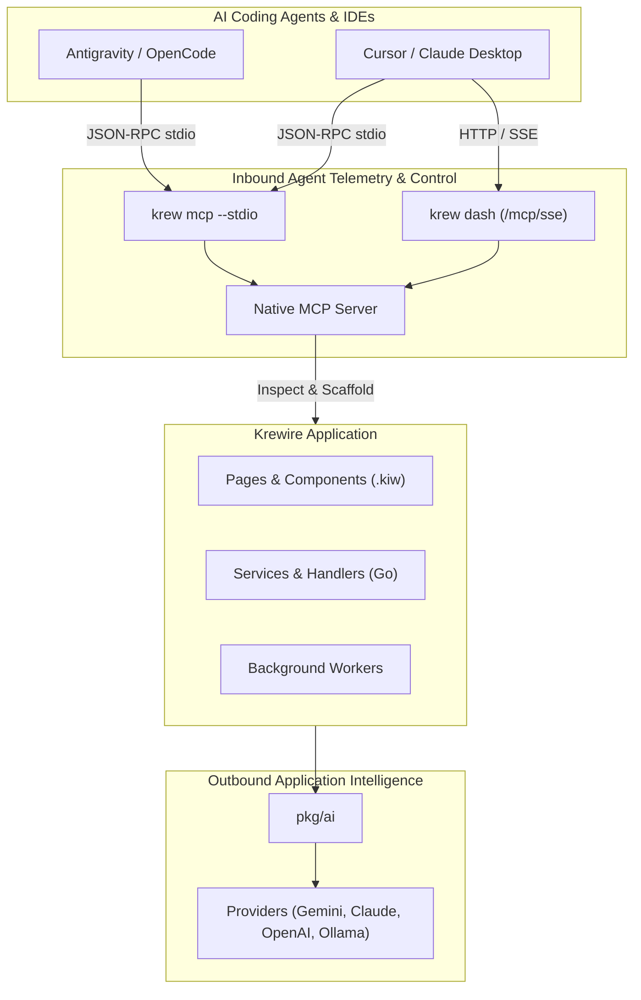

# Autonomous Agentic Development

Krewire is designed from first principles as an **Agent-Native Web & Cloud Ecosystem**. 

Rather than treating AI as an external chatbot that pastes unverified code into your editor, Krewire establishes bidirectional, structured agentic communication protocols. AI coding agents (Antigravity, Cursor, Claude Desktop, OpenCode, Cline) connect directly into your project's runtime to inspect configurations, analyze routes, monitor memory telemetry, and invoke verified scaffolding tools.

---

## 1. Dual Agentic Architecture



1. **Inbound Protocol (Native MCP Server)**: Agents query and command your Krewire project using the open [Model Context Protocol (MCP)](https://modelcontextprotocol.io/).
2. **Outbound Intelligence (Unified Go AI SDK)**: Your applications, HTTP handlers, and background workers generate structured outputs (`ai.GenerateObject[T]`), stream tokens, and call tools using `pkg/ai`.

---

## 2. Setting Up Inbound MCP for AI Agents

Every Krewire project can instantly serve as an MCP server with zero configuration.

### A. IDE Setup with stdio (`krew mcp --stdio`)

For **Cursor** (`.cursor/mcp.json`) or **Claude Desktop** (`claude_desktop_config.json`):

```json
{
  "mcpServers": {
    "krewire": {
      "command": "kiw",
      "args": ["mcp", "--stdio"]
    }
  }
}
```

For **OpenCode** (`opencode.json`):

```json
{
  "mcp": {
    "krewire": {
      "command": "kiw",
      "args": ["mcp", "--stdio"]
    }
  }
}
```

### B. Network / Browser Setup with HTTP/SSE

When developing microservices, containers, or using web-connected agents, start `krew dash`:

```bash
krew dash --port 4000
```

The MCP SSE server is automatically exposed at:

- **SSE Stream**: `http://127.0.0.1:4000/mcp/sse`
- **JSON-RPC Message Endpoint**: `http://127.0.0.1:4000/mcp/message`

---

## 3. Available MCP Resources & Tools

When an agent connects to `krewire-mcp`, it gains access to standardized resources and high-confidence actions:

### MCP Resources

| URI | Name | Description |
|---|---|---|
| `krewire://project/info` | Project Information | Project kind (`app`, `site`, `service`), title, Go toolchain, platform, and configured services. |
| `krewire://project/routes` | Routes Catalog | List of discovered `.kiw` pages, Markdown documents, and Go HTTP handlers. |
| `krewire://runtime/metrics` | Live Telemetry | Real-time memory allocation (MB), goroutines count, total sys memory, and GC stats. |
| `krewire://runtime/health` | Health Check | Continuous uptime and health status probe. |

### MCP Tools

| Tool Name | Parameters | Description |
|---|---|---|
| `kiw_inspect_project` | `{}` | Retrieve full project configuration, workload kind, and ecosystem topology. |
| `kiw_list_routes` | `{}` | Extract the entire routing catalog. |
| `kiw_make_scaffold` | `kind`, `name` | Safely scaffold a `component`, `page`, `handler`, `migration`, `model`, `middleware`, or `service` using verified generators. |
| `kiw_get_metrics` | `{}` | Query live goroutines and memory consumption. |
| `kiw_run_tests` | `pkg` (optional) | Execute `go test ./...` and return structured test outcome and output. |

---

## 4. Outbound Intelligence with `pkg/ai`

When your application needs to generate content, analyze user input, or run autonomous workflows, import `pkg/ai`:

```go
package main

import (
	"context"
	"fmt"
	"log"

	"github.com/krewire/krewire/pkg/ai"
	"github.com/krewire/krewire/pkg/ai/providers"
)

type CodeReview struct {
	Score       int      `json:"score" description:"Quality score from 1 to 10"`
	Suggestions []string `json:"suggestions" description:"Actionable improvements"`
}

func main() {
	client := providers.NewGeminiClient("gemini-2.5-pro", "")

	prompt := "Review this Go function: func Add(a, b int) int { return a + b }"
	review, err := ai.GenerateObject[CodeReview](context.Background(), client, prompt)
	if err != nil {
		log.Fatalf("Analysis failed: %v", err)
	}

	fmt.Printf("Quality Score: %d/10\n", review.Score)
	for _, s := range review.Suggestions {
		fmt.Printf("- %s\n", s)
	}
}
```

---

## 5. Installing the Boost AI Constitution

To equip your project with a full software development lifecycle agent matrix, run:

```bash
krew boost install
```

This installs:

- `AGENTS.md` — The agent constitution and operational boundaries.
- `.cursor/mcp.json` & `opencode.json` — Pre-wired MCP server definitions.
- `.agents/` — 21 specialist subagent personas across 5 functional clusters.
- `.workflow/` — 6-phase autonomous SDLC execution rules and quality gates.

---

## 6. The 21 Autonomous Agent Roles & Specialization Clusters

Krewire Boost defines 21 specialized subagents operating under strict separation of concerns:

### 1. Governance & Leadership
- **`leader` (Outcome Authority)**: Owns final acceptance, release readiness, and scope trade-offs.
- **`orchestrator` (Multi-Agent Coordinator)**: Coordinates multi-phase execution graphs across subagents.
- **`manager` (Clarification & Routing)**: Disambiguates vague requests and routes tasks to the fittest subagent.
- **`supervisor` (Runtime Monitoring)**: Monitors agent execution timeouts, retry budgets, and error recovery.

### 2. Architecture & Design
- **`planner` (Requirements & Backlog)**: Elicits PRDs, work breakdown structures (WBS), and user stories.
- **`thinker` (Architectural Reasoning)**: Evaluates technical trade-offs, ADRs, and alternative designs (read-only).
- **`designer` (System Architecture)**: Translates requirements into C4 diagrams, ERDs, API schemas, and threat models.

### 3. Implementation & Refactoring
- **`builder` (Feature Implementation)**: Writes production Go code, implements features, and fixes bugs.
- **`decomposer` (SRP & Clean Code)**: Decomposes oversized god-classes and functions into single-responsibility units.
- **`automator` (Tooling & Scripting)**: Scaffolds devtools, code generators, batch scripts, and CI workflows.
- **`customizer` (Agent Store Tailoring)**: Standardizes custom agents, skills, slash commands, and project rules.

### 4. Verification, Testing & Security
- **`tester` (Quality Assurance)**: Writes unit tests, table-driven tests, HTTP test harnesses, and verifies coverage.
- **`auditor` (Security & Compliance)**: Audits code against OWASP Top 10, CWE-22 (SafePath), CWE-918 (SSRF), and secret leaks.
- **`tracker` (GitHub Issues & SSOT)**: Discovers open issues, updates task checklists (`- [ ]` → `- [x]`), and maintains issue traceability.

### 5. Operations & Knowledge Hygiene
- **`deployer` (CI/CD & Infrastructure)**: Manages deployment targets (systemd, Docker, binary, GitHub Pages) and infrastructure blueprints.
- **`maintainer` (Operations & Triage)**: Triages bugs, updates dependencies, and resolves technical debt.
- **`explorer` (Codebase Exploration)**: Scans unfamiliar repositories, maps directory structures, and locates symbols.
- **`researcher` (External Research)**: Evaluates external libraries, RFC specifications, and industry best practices.
- **`housekeeper` (Memory & Knowledge Hygiene)**: Prunes outdated session context, tidies temporary files, and maintains index documentation.
- **`learner` (Self-Improvement)**: Consolidates developer preferences and corrected agent mistakes into persistent project rules.
- **`writer` (Documentation & Copy)**: Authors documentation, API references, Go docstrings, and UI copy.

---

## 7. Autonomous Execution Lifecycle & Slash Commands

Every agent task moves through a deterministic six-stage lifecycle:

```text
[1. Understand] ──► [2. Map] ──► [3. Plan & Spec] ──► [4. Implement] ──► [5. Verify] ──► [6. Summarize]
```

### Slash Command Matrix

Boost provides user-facing shortcuts mapped directly to autonomous workflows:

- **Requirements & Planning**: `/plan`, `/spec`, `/grill-me` (Engages `planner`, `thinker`, `manager`).
- **Architecture & Design**: `/design`, `/adr` (Engages `designer`, `thinker`).
- **Implementation**: `/build`, `/refactor`, `/fix`, `/commit` (Engages `builder`, `decomposer`, `automator`).
- **Testing & Verification**: `/test`, `/audit`, `/verify` (Engages `tester`, `auditor`).
- **Release & Deployment**: `/deploy`, `/release` (Engages `deployer`, `maintainer`).
- **Hygiene & Evolution**: `/learn`, `/compact`, `/docs` (Engages `housekeeper`, `learner`, `writer`).

---

## 8. Alignment with the Three Pillars (3S)

- **Secure (S1)**: Inbound MCP enforces read-only inspection by default; dangerous mutations require explicit tool invocation. Subagent permissions adhere to the principle of least privilege.
- **Sustainable (S2)**: Pure Go MCP server without requiring Node.js runtime daemons or heavy Python orchestrator dependencies.
- **Scalable (S3)**: Swappable subagents and dual-channel (stdio / SSE) transports scale from single-developer laptops to multi-tenant cloud agent pipelines.
