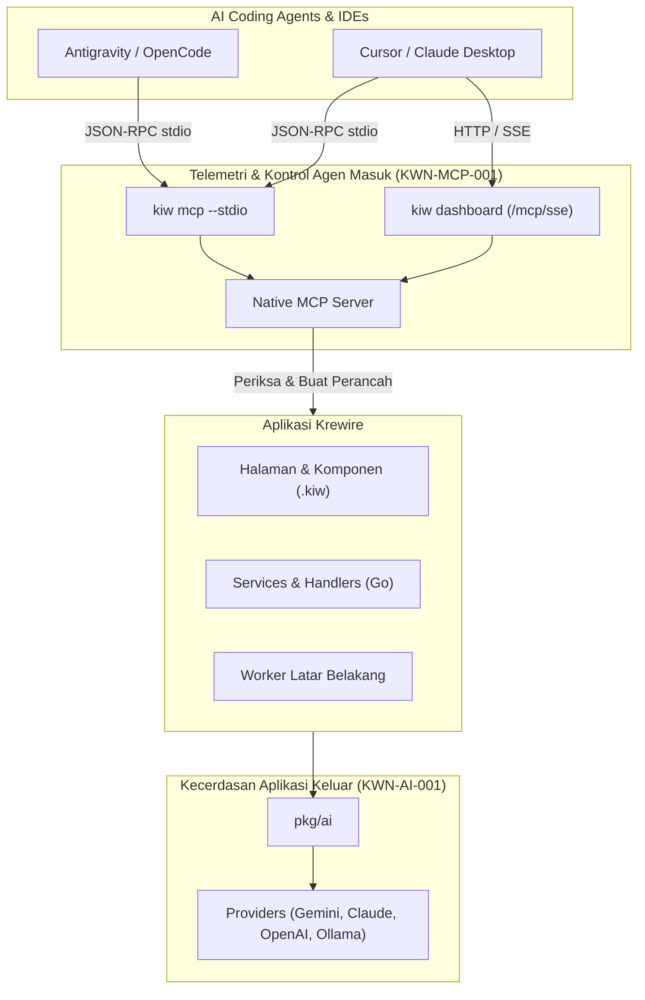

# Pengembangan Berbasis Agen Otonom (KWN-AGI-001)

Krewire dirancang sejak awal sebagai **Ekosistem Web & Cloud Native-Agen (Agent-Native)**.

Alih-alih memperlakukan AI sebagai chatbot eksternal yang menempelkan kode tanpa verifikasi ke editor Anda, Krewire membangun protokol komunikasi agen dua arah yang terstruktur. AI coding agent (Antigravity, Cursor, Claude Desktop, OpenCode, Cline) terhubung langsung ke runtime proyek Anda untuk memeriksa konfigurasi, menganalisis rute, memantau telemetri memori, serta memanggil perkakas perancah (scaffolding) yang terverifikasi.

---

## 1. Arsitektur Agen Ganda (Dual Agentic Architecture)



1. **Protokol Masuk (Native MCP Server)**: Agen meminta informasi dan memberikan perintah ke proyek Krewire Anda menggunakan standar terbuka [Model Context Protocol (MCP)](https://modelcontextprotocol.io/).
2. **Kecerdasan Keluar (Unified Go AI SDK)**: Aplikasi, HTTP handler, dan background worker Anda menghasilkan output terstruktur (`ai.GenerateObject[T]`), melakukan streaming token, dan memanggil tools menggunakan `pkg/ai`.

---

## 2. Menyiapkan Inbound MCP untuk Agen AI

Setiap proyek Krewire dapat langsung berfungsi sebagai server MCP dengan nol konfigurasi tambahan.

### A. Konfigurasi IDE dengan stdio (`kiw mcp --stdio`)

Untuk **Cursor** (`.cursor/mcp.json`) atau **Claude Desktop** (`claude_desktop_config.json`):

```json
{
  "mcpServers": {
    "krewire": {
      "command": "kiw",
      "args": ["mcp", "--stdio"]
    }
  }
}
```

Untuk **OpenCode** (`opencode.json`):

```json
{
  "mcp": {
    "krewire": {
      "command": "kiw",
      "args": ["mcp", "--stdio"]
    }
  }
}
```

### B. Konfigurasi Jaringan / Browser dengan HTTP/SSE

Saat mengembangkan layanan mikro, kontainer, atau menggunakan agen yang terhubung melalui web, jalankan `kiw dashboard`:

```bash
kiw dashboard --port 4000
```

Server MCP SSE secara otomatis tersedia di:
- **Aliran SSE (SSE Stream)**: `http://127.0.0.1:4000/mcp/sse`
- **Endpoint Pesan JSON-RPC**: `http://127.0.0.1:4000/mcp/message`

---

## 3. Resource & Tool MCP yang Tersedia

Saat agen terhubung ke `krewire-mcp`, agen memperoleh akses ke resource terstandarisasi dan tindakan berkeyakinan tinggi (high-confidence actions):

### Resource MCP

| URI | Nama | Deskripsi |
|---|---|---|
| `krewire://project/info` | Informasi Proyek | Jenis proyek (`app`, `site`, `service`), judul, toolchain Go, platform, dan layanan yang terkonfigurasi. |
| `krewire://project/routes` | Katalog Rute | Daftar halaman `.kiw` yang ditemukan, dokumen Markdown, dan HTTP handler Go. |
| `krewire://runtime/metrics` | Telemetri Langsung | Alokasi memori real-time (MB), jumlah goroutine, total memori sistem, dan statistik GC. |
| `krewire://runtime/health` | Pemeriksaan Kesehatan | Probe uptime dan status kesehatan berkelanjutan. |

### Tool MCP

| Nama Tool | Parameter | Deskripsi |
|---|---|---|
| `kiw_inspect_project` | `{}` | Mengambil konfigurasi lengkap proyek, jenis workload, dan topologi ekosistem. |
| `kiw_list_routes` | `{}` | Mengekstrak seluruh katalog perutean. |
| `kiw_make_scaffold` | `kind`, `name` | Membuat perancah `component`, `page`, `handler`, `migration`, `model`, `middleware`, atau `service` secara aman menggunakan generator terverifikasi. |
| `kiw_get_metrics` | `{}` | Meminta telemetri jumlah goroutine dan konsumsi memori saat itu juga. |
| `kiw_run_tests` | `pkg` (opsional) | Menjalankan `go test ./...` dan mengembalikan hasil pengujian serta output secara terstruktur. |

---

## 4. Kecerdasan Keluar dengan `pkg/ai`

Ketika aplikasi Anda perlu menghasilkan konten, menganalisis masukan pengguna, atau menjalankan alur kerja otonom, impor `pkg/ai`:

```go
package main

import (
	"context"
	"fmt"
	"log"

	"github.com/krewire/krewire/pkg/ai"
	"github.com/krewire/krewire/pkg/ai/providers"
)

type CodeReview struct {
	Score       int      `json:"score" description:"Quality score from 1 to 10"`
	Suggestions []string `json:"suggestions" description:"Actionable improvements"`
}

func main() {
	client := providers.NewGeminiClient("gemini-2.5-pro", "")

	prompt := "Review this Go function: func Add(a, b int) int { return a + b }"
	review, err := ai.GenerateObject[CodeReview](context.Background(), client, prompt)
	if err != nil {
		log.Fatalf("Analysis failed: %v", err)
	}

	fmt.Printf("Quality Score: %d/10\n", review.Score)
	for _, s := range review.Suggestions {
		fmt.Printf("- %s\n", s)
	}
}
```

---

## 5. Memasang Konstitusi AI Boost

Untuk melengkapi proyek Anda dengan matriks agen siklus hidup pengembangan perangkat lunak (SDLC) yang lengkap, jalankan:

```bash
kiw boost install
```

Perintah ini akan memasang:
- `AGENTS.md` — Konstitusi agen dan batasan operasional.
- `.cursor/mcp.json` & `opencode.json` — Definisi server MCP yang telah terkonfigurasi.
- `.agents/` — Persona subagen spesialis (`planner`, `designer`, `builder`, `tester`, `deployer`, `maintainer`, `auditor`).
