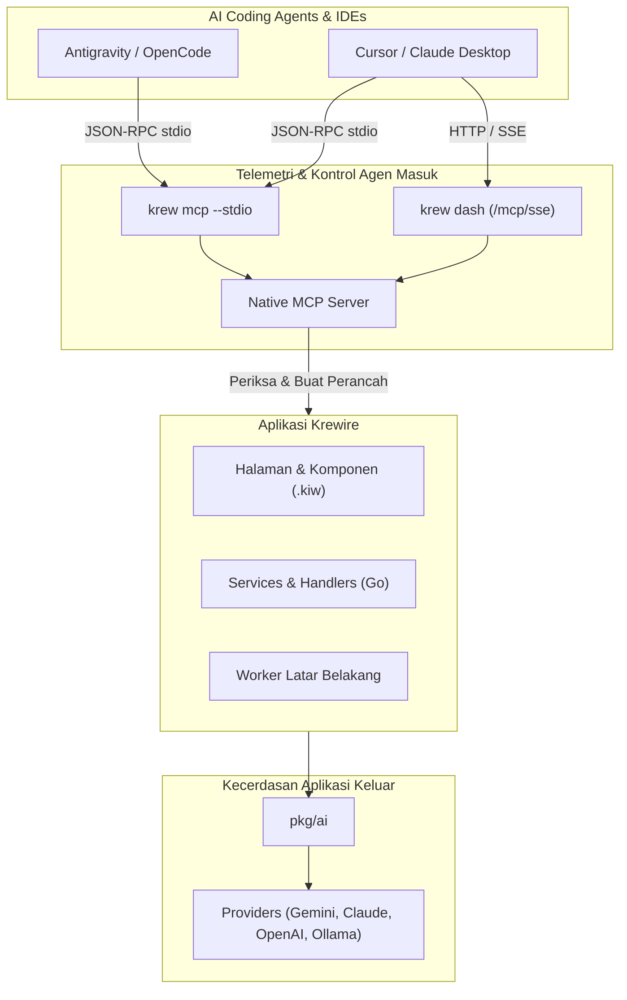

# Pengembangan Berbasis Agen Otonom

Krewire dirancang sejak awal sebagai **Ekosistem Web & Cloud Native-Agen (Agent-Native)**.

Alih-alih memperlakukan AI sebagai chatbot eksternal yang menempelkan kode tanpa verifikasi ke editor Anda, Krewire membangun protokol komunikasi agen dua arah yang terstruktur. AI coding agent (Antigravity, Cursor, Claude Desktop, OpenCode, Cline) terhubung langsung ke runtime proyek Anda untuk memeriksa konfigurasi, menganalisis rute, memantau telemetri memori, serta memanggil perkakas perancah (scaffolding) yang terverifikasi.

---

## 1. Arsitektur Agen Ganda (Dual Agentic Architecture)



1. **Protokol Masuk (Native MCP Server)**: Agen meminta informasi dan memberikan perintah ke proyek Krewire Anda menggunakan standar terbuka [Model Context Protocol (MCP)](https://modelcontextprotocol.io/).
2. **Kecerdasan Keluar (Unified Go AI SDK)**: Aplikasi, HTTP handler, dan background worker Anda menghasilkan output terstruktur (`ai.GenerateObject[T]`), melakukan streaming token, dan memanggil tools menggunakan `pkg/ai`.

---

## 2. Menyiapkan Inbound MCP untuk Agen AI

Setiap proyek Krewire dapat langsung berfungsi sebagai server MCP dengan nol konfigurasi tambahan.

### A. Konfigurasi IDE dengan stdio (`krew mcp --stdio`)

Untuk **Cursor** (`.cursor/mcp.json`) atau **Claude Desktop** (`claude_desktop_config.json`):

```json
{
  "mcpServers": {
    "krewire": {
      "command": "kiw",
      "args": ["mcp", "--stdio"]
    }
  }
}
```

Untuk **OpenCode** (`opencode.json`):

```json
{
  "mcp": {
    "krewire": {
      "command": "kiw",
      "args": ["mcp", "--stdio"]
    }
  }
}
```

### B. Konfigurasi Jaringan / Browser dengan HTTP/SSE

Saat mengembangkan layanan mikro, kontainer, atau menggunakan agen yang terhubung melalui web, jalankan `krew dash`:

```bash
krew dash --port 4000
```

Server MCP SSE secara otomatis tersedia di:

- **Aliran SSE (SSE Stream)**: `http://127.0.0.1:4000/mcp/sse`
- **Endpoint Pesan JSON-RPC**: `http://127.0.0.1:4000/mcp/message`

---

## 3. Resource & Tool MCP yang Tersedia

Saat agen terhubung ke `krewire-mcp`, agen memperoleh akses ke resource terstandarisasi dan tindakan berkeyakinan tinggi (high-confidence actions):

### Resource MCP

| URI | Nama | Deskripsi |
|---|---|---|
| `krewire://project/info` | Informasi Proyek | Jenis proyek (`app`, `site`, `service`), judul, toolchain Go, platform, dan layanan yang terkonfigurasi. |
| `krewire://project/routes` | Katalog Rute | Daftar halaman `.kiw` yang ditemukan, dokumen Markdown, dan HTTP handler Go. |
| `krewire://runtime/metrics` | Telemetri Langsung | Alokasi memori real-time (MB), jumlah goroutine, total memori sistem, dan statistik GC. |
| `krewire://runtime/health` | Pemeriksaan Kesehatan | Probe uptime dan status kesehatan berkelanjutan. |

### Tool MCP

| Nama Tool | Parameter | Deskripsi |
|---|---|---|
| `kiw_inspect_project` | `{}` | Mengambil konfigurasi lengkap proyek, jenis workload, dan topologi ekosistem. |
| `kiw_list_routes` | `{}` | Mengekstrak seluruh katalog perutean. |
| `kiw_make_scaffold` | `kind`, `name` | Membuat perancah `component`, `page`, `handler`, `migration`, `model`, `middleware`, atau `service` secara aman menggunakan generator terverifikasi. |
| `kiw_get_metrics` | `{}` | Meminta telemetri jumlah goroutine dan konsumsi memori saat itu juga. |
| `kiw_run_tests` | `pkg` (opsional) | Menjalankan `go test ./...` dan mengembalikan hasil pengujian serta output secara terstruktur. |

---

## 4. Kecerdasan Keluar dengan `pkg/ai`

Ketika aplikasi Anda perlu menghasilkan konten, menganalisis masukan pengguna, atau menjalankan alur kerja otonom, impor `pkg/ai`:

```go
package main

import (
	"context"
	"fmt"
	"log"

	"github.com/krewire/krewire/pkg/ai"
	"github.com/krewire/krewire/pkg/ai/providers"
)

type CodeReview struct {
	Score       int      `json:"score" description:"Quality score from 1 to 10"`
	Suggestions []string `json:"suggestions" description:"Actionable improvements"`
}

func main() {
	client := providers.NewGeminiClient("gemini-2.5-pro", "")

	prompt := "Review this Go function: func Add(a, b int) int { return a + b }"
	review, err := ai.GenerateObject[CodeReview](context.Background(), client, prompt)
	if err != nil {
		log.Fatalf("Analysis failed: %v", err)
	}

	fmt.Printf("Quality Score: %d/10\n", review.Score)
	for _, s := range review.Suggestions {
		fmt.Printf("- %s\n", s)
	}
}
```

---

## 5. Memasang Konstitusi AI Boost

Untuk melengkapi proyek Anda dengan matriks agen siklus hidup pengembangan perangkat lunak (SDLC) yang lengkap, jalankan:

```bash
krew boost install
```

Perintah ini akan memasang:

- `AGENTS.md` — Konstitusi agen dan batasan operasional workspace.
- `.cursor/mcp.json` & `opencode.json` — Definisi server MCP yang telah terkonfigurasi.
- `.agents/` — 21 persona subagen spesialis di 5 kluster fungsional.
- `.workflow/` — Aturan eksekusi SDLC otonom 6-fase dan gerbang kualitas (quality gates).

---

## 6. 21 Peran Agen Otonom & Kluster Spesialisasi

Krewire Boost mendefinisikan 21 subagen terspesialisasi yang beroperasi di bawah prinsip pemisahan tanggung jawab (Separation of Concerns) yang ketat:

### 1. Tata Kelola & Kepemimpinan (Governance & Leadership)
- **`leader` (Otoritas Hasil)**: Memiliki wewenang penerimaan akhir, kesiapan rilis, dan kompromi cakupan.
- **`orchestrator` (Koordinator Multi-Agen)**: Mengoordinasikan graf eksekusi multi-fase di seluruh subagen.
- **`manager` (Klarifikasi & Perutean)**: Mengklarifikasi permintaan ambigu dan merutekan tugas ke subagen yang paling sesuai.
- **`supervisor` (Pemantau Runtime)**: Memantau batas waktu eksekusi agen, anggaran percobaan ulang, dan pemulihan galat.

### 2. Arsitektur & Desain (Architecture & Design)
- **`planner` (Kebutuhan & Backlog)**: Menyusun PRD, rincian struktur kerja (WBS), dan cerita pengguna (user stories).
- **`thinker` (Penalaran Arsitektural)**: Mengevaluasi trade-off teknis, ADR, dan desain alternatif (bersifat read-only).
- **`designer` (Arsitektur Sistem)**: Menerjemahkan kebutuhan ke dalam diagram C4, ERD, skema API, dan model ancaman keamanan.

### 3. Implementasi & Refaktorisasi (Implementation & Refactoring)
- **`builder` (Implementasi Fitur)**: Menulis kode produksi Go, mengimplementasikan fitur, dan memperbaiki bug.
- **`decomposer` (SRP & Clean Code)**: Mendekomposisi god-class dan fungsi monolitik menjadi unit berkemampuan tunggal.
- **`automator` (Perkakas & Skrip)**: Membuat scaffolding perkakas pengembang, generator kode, skrip batch, dan alur CI.
- **`customizer` (Kustomisasi Toko Agen)**: Membakukan agen kustom, skills, slash commands, dan aturan proyek.

### 4. Verifikasi, Pengujian & Keamanan (Verification, Testing & Security)
- **`tester` (Penjaminan Kualitas)**: Menulis pengujian unit, tabel data uji, harness pengujian HTTP, dan memverifikasi cakupan kode.
- **`auditor` (Keamanan & Kepatuhan)**: Mengaudit kode terhadap OWASP Top 10, CWE-22 (SafePath), CWE-918 (SSRF), dan kebocoran rahasia.
- **`tracker` (Pelacakan Isu GitHub SSOT)**: Menemukan isu terbuka, memperbarui checklist tugas (`- [ ]` → `- [x]`), dan menjaga ketertelusuran isu.

### 5. Operasional & Higienitas Pengetahuan (Operations & Knowledge Hygiene)
- **`deployer` (CI/CD & Infrastruktur)**: Mengelola target deployment (systemd, Docker, biner, GitHub Pages) dan blueprint infrastruktur.
- **`maintainer` (Operasi & Triase)**: Melakukan triase bug, memperbarui dependensi, dan menyelesaikan utang teknis.
- **`explorer` (Eksplorasi Basis Kode)**: Memindai repositori baru, memetakan struktur direktori, dan menemukan simbol kode.
- **`researcher` (Riset Eksternal)**: Mengevaluasi library eksternal, spesifikasi RFC, dan praktik terbaik industri.
- **`housekeeper` (Higienitas Memori & Pengetahuan)**: Memangkas konteks sesi yang usang, merapikan file sementara, dan memelihara dokumentasi indeks.
- **`learner` (Penyempurnaan Diri)**: Mengonsolidasikan preferensi pengembang dan koreksi kesalahan agen menjadi aturan proyek persisten.
- **`writer` (Dokumentasi & Redaksi)**: Menulis dokumentasi, referensi API, docstring Go, dan salinan antarmuka pengguna.

---

## 7. Siklus Hidup Eksekusi Otonom & Slash Commands

Setiap tugas agen bergerak melalui siklus deterministik enam tahap:

```text
[1. Pahami] ──► [2. Petakan] ──► [3. Rencanakan] ──► [4. Implementasikan] ──► [5. Verifikasi] ──► [6. Simpulkan]
```

### Matriks Slash Commands

Boost menyediakan pintasan perintah pengguna yang dipetakan langsung ke alur kerja otonom:

- **Kebutuhan & Perencanaan**: `/plan`, `/spec`, `/grill-me` (Melibatkan `planner`, `thinker`, `manager`).
- **Arsitektur & Desain**: `/design`, `/adr` (Melibatkan `designer`, `thinker`).
- **Implementasi**: `/build`, `/refactor`, `/fix`, `/commit` (Melibatkan `builder`, `decomposer`, `automator`).
- **Pengujian & Verifikasi**: `/test`, `/audit`, `/verify` (Melibatkan `tester`, `auditor`).
- **Rilis & Deployment**: `/deploy`, `/release` (Melibatkan `deployer`, `maintainer`).
- **Higienitas & Evolusi**: `/learn`, `/compact`, `/docs` (Melibatkan `housekeeper`, `learner`, `writer`).

---

## 8. Keselarasan dengan Tiga Pilar (3S)

- **Aman (S1 - Secure)**: Inbound MCP menegakkan inspeksi baca-saja secara bawaan; perubahan berbahaya memerlukan pemanggilan tool eksplisit. Izin subagen mematuhi prinsip hak istimewa paling rendah (least privilege).
- **Berkelanjutan (S2 - Sustainable)**: Server MCP murni Go tanpa memerlukan daemon runtime Node.js atau orchestrator Python yang berat.
- **Skalabel (S3 - Scalable)**: Subagen modular dan transport dwi-kanal (stdio / SSE) dapat diskalakan dari laptop pengembang mandiri hingga pipeline agen cloud multi-tenant.
